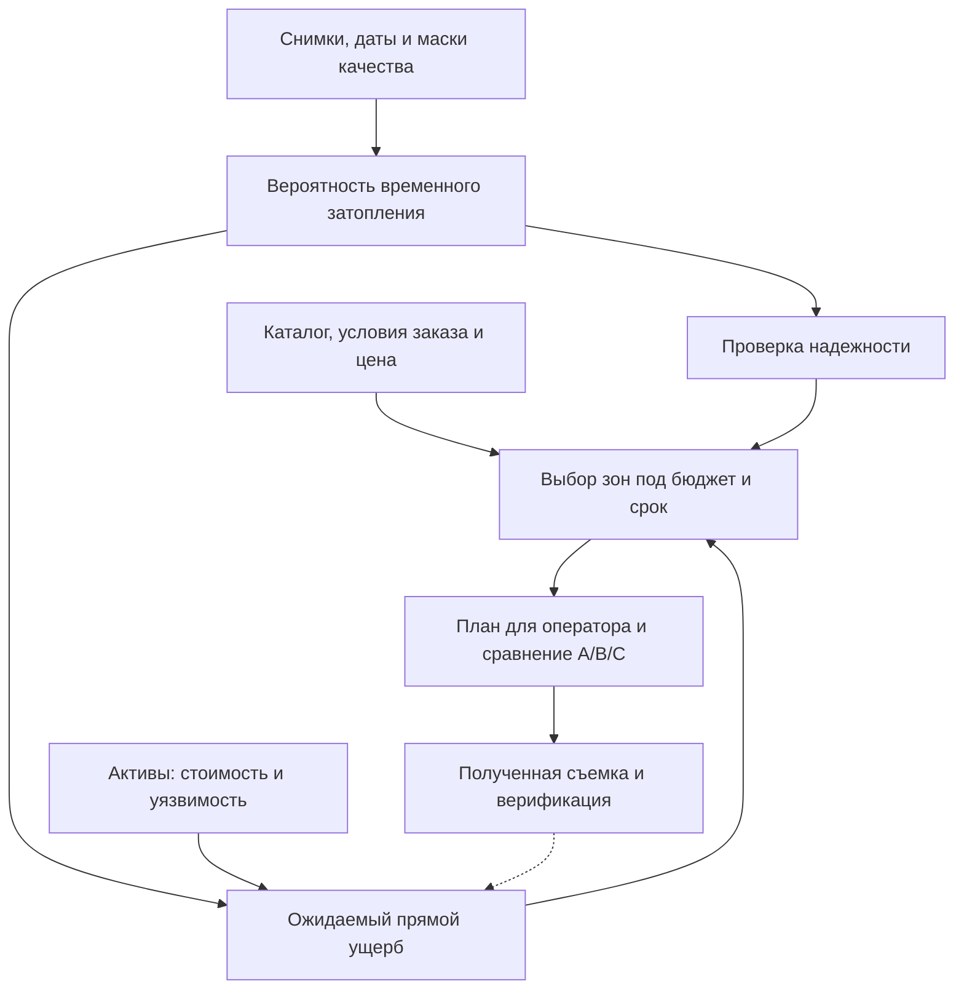

# Постановка кейса

Источник: `FloodValue_Постановка_КосмоХакатон.pdf`, раздел I (с. 2-7).

## Какое решение принимает пользователь

После паводка оператору нужно понять, где может быть вода, какие объекты дают наибольший ожидаемый прямой ущерб, насколько прогнозу можно верить и где дополнительная съемка даст полезную информацию при имеющемся бюджете. Sentinel-1 видит сквозь облака, Sentinel-2 добавляет спектр там, где есть пригодная оптика, а высокодетальная съемка всей территории слишком дорогая.

Итог для оператора: карта воды, оценки риска по десяти объектам, обоснованный план съемки и сравнение A/B/C. Смена бюджета пересчитывает план без повторного обучения модели.

На защите надо объяснить четыре стороны результата: пользователь, его действие, срок и цена ошибки.

## Пять задач

На одном чипе Sentinel-1 из официального Sen1Floods11:

1. Найти воду двумя обязательными методами, а для основного получить и проверить вероятности. «Временным затоплением» результат можно назвать только при обоснованном отделении постоянной воды, иначе это «карта воды».
2. Перенести прогноз на объекты или ячейки и оценить прямой ожидаемый ущерб.
3. Оценить надежность и проверить связь выбранного показателя неопределенности с ошибками.
4. Самостоятельно построить зоны дополнительной съемки, посчитать площадь и стоимость, выбрать план при объявленном бюджете.
5. Сравнить открытые данные, широкую закупку и выборочную закупку по приоритетам модели.

## Логика проекта (рисунок 1 постановки)

Поступление новой съемки считается следующим этапом. Если реальных новых наблюдений нет, эффект закупки оценивается только сценарно и так и подписывается.

## Обязательное и свободное

| Обязательно для всех | Команда выбирает |
|---|---|
| Независимое разделение S1-данных без утечки; пороговый baseline и самостоятельный основной метод; сравнение на одних валидных test-пикселях | Архитектуру и настройки основного метода (ML, нейросеть, гибрид) |
| Вероятности и бинарная маска основного метода; карта воды или обоснованное временное затопление | Дополнительные признаки, методы калибровки, вероятностное расширение baseline |
| Один случайный портфель из 10 объектов; EL по вероятностям основного метода; проверка неопределенности | Дополнительные экономические эксперименты, в том числе сравнение с baseline |
| Собственные зоны от 1 км² без holes, цена по контуру, соблюдение объявленного бюджета | Алгоритм поиска плана, ограничения на важные объекты |
| A/B/C на одной карте и одном портфеле; лимит на полную стоимость платных данных в C | Вид интерфейса: карта, отчет, панель, GIS-плагин, API |
| Стандартные файлы, весь код и веса в GitVerse, воспроизводимый запуск на официальном S1 | Среду запуска, дизайн, структуру выступления |

Простая замена порога baseline новым методом не считается. Основной метод обязан запускаться только по S1, даже если команда подключила S2 или другие данные.

## Чего организатор не дает

Готового split на train/validation/test, синтетических снимков, портфелей и координат объектов, примера решения, кандидатных зон, прайс-листа поставщика, скрытой проверочной выборки, эталонных предсказаний и обученных моделей. Нормативные примеры в постановке объясняют логику расчета, но не заменяют результаты команды.

Скрытого теста у жюри нет. Зато жюри может взять любой другой S1-чип из официального набора и запустить на нем обученную модель без подгонки.

## Практический маршрут

| Шаг | Вопрос | Где в разборе |
|---|---|---|
| 1. Данные | Что наблюдал спутник, что означает метка, где нет данных? | [02](02-data-sen1floods11.md) |
| 2. Простой ориентир | Какое качество дает объяснимое правило или простая модель? | [03](03-methods-validation.md) |
| 3. Основной подход | Что улучшилось на новом событии и за счет чего? | [03](03-methods-validation.md) |
| 4. Экономика | Как вероятность переходит в рубли и насколько им можно верить? | [04](04-economics-assets.md) |
| 5. Заказ | Что купить, когда это будет доступно, какова полная цена? | [05](05-procurement-pricing.md) |
| 6. Продукт | Как оператор использует вывод за 6-12 часов? | [06](06-deliverables.md) |

Минимум один контролируемый эксперимент, обосновывающий конфигурацию основного метода, обязателен. Настраивать его по независимому test нельзя.

## Правила по данным

- Единственный обязательный источник: официальный Sen1Floods11. Организатор не перепаковывает его в конкурсный архив, данные берем по ссылкам из README репозитория авторов.
- Другие открытые бесплатные источники разрешены (OSM, рельеф, земной покров, спутниковая оптика, открытые предобученные модели). Для каждого фиксируем URL, версию или дату, лицензию, используемые атрибуты и ограничения.
- Для имитации оперативного решения нельзя использовать информацию, появившуюся после даты анализируемого события.
- Ручные метки Sen1Floods11 различают воду, не-воду и невалидные пиксели, но не отделяют временное затопление от постоянной воды. Отделение делаем сами, временно корректным источником, либо честно называем результат «карта воды».

## Кто пользователь

На защите один процесс должен быть доведен до результата. Постановка предлагает три варианта:

| Пользователь | Действие | Что проверить в пилоте |
|---|---|---|
| Инфраструктурный оператор | Очередность осмотров и дополнительной съемки | Время от данных до решения, пропуски значимых объектов, доля ручной проверки |
| Страховой аналитик | Предварительное ранжирование заявлений и план верификации | Связь с обследованными потерями, стоимость проверки, калибровка, ограничения для резервов |
| Оператор ДЗЗ или космическое агентство | Обоснование приоритетов заказа и мощности обработки | Выполнение срока, доля использованных продуктов, цена полезного наблюдения |

Обязательных KPI нет. Потенциальный спрос и экономия становятся фактами только после пилотных измерений, до этого это гипотезы.

## Границы применения

- Расчет относится к одному событию и прямому ущербу заданного портфеля. Это не годовой ожидаемый ущерб, не страховое возмещение и не официальная оценка.
- Покупка данных сама по себе не предотвращает физические потери.
- Демонстрация идет на одном чипе с 10 объектами. Перенос на тысячи километров и реальные реестры инфраструктуры относится к развитию продукта.
- Горизонт 6-12 часов описывает сценарий использования продукта, а не время на обучение модели.

## Что показывает литература

Постановка приводит два графика и прямо говорит, что это не пороги баллов и не метрики, которые можно приписать своему прототипу.

Средний IoU по чипам для класса «паводковая вода» из статьи авторов набора (Bonafilia et al., CVPR Workshops 2020, табл. 1, 10 событий без Bolivia):

| Вариант | Mean IoU |
|---|---|
| Обучение на S2 weak | 33,89% |
| Порог Otsu по VH | 28,50% |
| Обучение на S1 weak | 24,22% |
| Обучение на ручных метках | 24,21% |
| Обучение на постоянной воде | 16,93% |

Порог Otsu в той работе обошел CNN на ручных метках, так что сильный baseline здесь вполне реален, и основной метод надо защищать не одной цифрой IoU.

Второй график: функции «глубина → доля ущерба» JRC (Huizinga, de Moel, Szewczyk, 2017, табл. 5-4). Доля ущерба растет с глубиной примерно до 100% на 6 м. Вероятность воды на снимке глубину не сообщает, поэтому в кейсе q задан фиксированно, а переносить функции JRC можно только с проверкой применимости.
