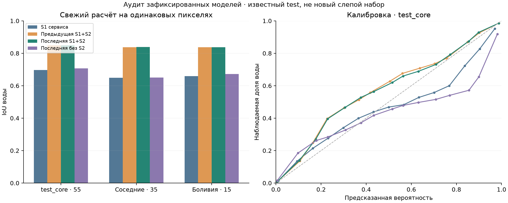

# Выбор модели и повторная проверка — 26.09.2026

## Что выбрано

Последний поставляемый кандидат — **`ml/artifacts/next_optical/recipe.json`**, смесь `boost_learned`, порог **0,46**. SHA256 рецепта: `7527a498b586c396661f51d0b373e1b36e7b11ae483161af47efd69f3de1c9e0`. Состав: прежний радарный ансамбль с четырьмя поворотами и смесь HGB/LightGBM/CatBoost по S2. При отсутствии допустимой оптики — S1 fallback. Выбор пакета сделан до свежей оценки, веса/пороги/калибратор не менялись.

Выбор кандидата, проверка и внедрение — разные этапы. Запущенный веб-сервис в этом сеансе на новую модель не переключался. Протокол сравнения: [INDEPENDENT_AUDIT_PROTOCOL.md](../ml/research/INDEPENDENT_AUDIT_PROTOCOL.md).

## Свежие результаты

Обработаны 105 чипов, 23 268 393 общих валидных пикселя. Два чипа test_core (Ghana_83483, Paraguay_34417) не имеют валидных контрольных пикселей: их метрики пустые, не нулевые. Все прогнозы заново получены из весов; опубликованные IoU воспроизвелись до шести знаков.

| Пакет | IoU test_core | IoU соседних test | IoU Bolivia | Brier test_core ↓ | ECE test_core ↓ |
|---|---:|---:|---:|---:|---:|
| VH baseline | 0,519084 | 0,554496 | 0,534630 | — | — |
| S1 текущего сервиса | 0,696958 | 0,648442 | 0,659276 | 0,036010 | 0,011843 |
| Предыдущий S1+S2 | 0,848688 | 0,837328 | 0,836838 | 0,016959 | 0,006041 |
| **Последний S1+S2** | **0,849383** | **0,838132** | **0,837351** | **0,016897** | **0,006152** |
| Последний, S2 отключён | 0,706598 | 0,650309 | 0,672399 | 0,037232 | 0,024083 |

Для последнего пакета на test_core: F1 **0,918558**, precision **0,953192**, recall **0,886353**. Полные confusion matrices, показатели по событиям/чипам и неопределённости — в [metrics.json](../ml/research/audit_20260926/metrics.json) и [CSV](../ml/research/audit_20260926/per_chip_metrics.csv).

### Вывод для выбора версии

- Против S1 сервиса расширение даёт **+0,152425 IoU** на test_core. Это преимущество режима с дополнительной оптикой, а не чистого S1. В 17 из 105 чипов оптика отклонена по дате (Гана/Испания), и эти чипы остаются в оценке.
- Против предыдущего S1+S2 прирост **+0,000695 IoU**. Парный описательный bootstrap по 9 событиям, 2 000 повторов: **[−0,001379; +0,002146]**. Ноль внутри интервала — устойчивое преимущество новой смеси не подтверждено. ECE слегка ухудшился.
- **S1 fallback требует работы с калибровкой:** IoU лучше исходного на 0,009640, но Brier хуже, ECE вырос с 0,011843 до 0,024083. Нельзя считать более красивую маску доказательством более надёжного p для EL.
- На двух test_core-чипах Меконга новая версия хуже предыдущей: IoU **0,3254 → 0,2785**. Общая метрика скрывает этот локальный регресс. На 46 чипах без соседей train/validation исходный S1 даёт **0,6130**, новый S1+S2 — **0,7833**; это диагностический срез тех же известных событий.
- Условный EL-прокси на 457 размеченных точках из 550 test_core: средняя абсолютная ошибка `pVq` против `yVq` **214 249 → 92 034 ₽**. Это дополнительная диагностика на фиксированных учебных V/q, не измерение реального ущерба или предотвращённых потерь.

**Решение:** `next_optical` зафиксирован как последняя проверенная кандидатная версия для дальнейшей интеграции. Автоматическая замена сервиса не выполнена: сначала устранить проблемы режима без S2, проверить RTC и получить независимые новые события. Предыдущий S1+S2 сохранить как контроль: оснований обещать заметное преимущество новой смеси над ним пока нет.

Технически: **29 тестов прошли**; проверены реальные веса, пропуски S2/будущие даты/частичный nodata и CLI на CPU. На заранее выбранном Ghana_313799 CPU/MPS: среднее различие p **2,84×10⁻⁹**, различий масок **0**. CPU CLI занял **11,44 с** вместе с импортами/загрузкой, без оптической ветки; это один запуск, не p95. [Протокол, команды и доказательства](../ml/research/audit_20260926/README.md).

Параллельно в origin/main появились коммиты `ec5a0bc`, `479c15a`, `24ff3a5`, `502fea5`: порог/мера сомнений для прежнего S1 выбираются на validation, RTC-преобразование — на train CV, добавлен журнал использования test. Проверенные здесь веса и рецепты ими не меняются. Новый пакет всё равно требует собственной проверки этих параметров; новые upstream-эксперименты в этом аудите не повторялись.

## Что требуется по ТЗ

Источник — постановка, с. 7–11, 21–22, и критерии 1–12. Организаторы не устанавливают минимальный IoU.

| Требование | Состояние и следующий шаг |
|---|---|
| Официальный S1, VV/VH, CRS, nodata и совмещение меток | Для аудита скачаны все 105 отложенных S1/S2/LabelHand и метаданные, MD5 проверены; геометрия проверяется отдельно. |
| Пороговый baseline и самостоятельный метод | Сравниваются VH-порог, исходный S1 сервиса, предыдущий S1+S2, последний S1+S2 и его режим без S2. |
| Одинаковые валидные пиксели, IoU/F1/precision/recall | Метрики считаются отдельным скриптом по общей маске конечного S1 и меток 0/1. Отсутствие S2 не исключает пиксели. |
| Разбиение, географический перенос, отсутствие настройки по test | Веса не видели 105 отложенных чипов по сохранённым спискам. Но test уже известен, а CV использовалась для выбора: это повторный аудит, не новый слепой тест. |
| Контролируемые эксперименты | Предыдущие эксперименты сохранены; в новом аудите сравниваются фиксированные пакеты и отключение S2. По новым метрикам ничего не подбирается. |
| Рабочий S1-only | Принудительно отключается оптика на всём test. Дополнительно проверены отсутствие S2, будущая дата и частично отсутствующие пиксели. |
| Калибровка p и неопределённость | Проверяются Brier/ECE, reliability, связь разброса и вероятности ошибки с реальными ошибками. Нужен отдельный контроль по регионам и доступности S2. |
| Согласованные GeoTIFF и повторный запуск | Проверяется настоящий пакетный CLI: геометрия, dtype, nodata, диапазон p, `mask = p ≥ threshold`, согласованность CPU/MPS. |
| Корректные дополнительные данные | S2 не позже S1 и максимум на два дня раньше. Точного времени суток нет. S2Hand — L1C/13 полос, штатной QA-маски нет; это ограничение текущего пакета. |
| p передаётся в EL и приоритеты | Дополнительно сравнивается pVq с yVq для десяти фиксированных случайных точек на каждом чипе. Это прокси по меткам воды, не фактический ущерб. |
| Код, веса, версия, воспроизведение | Зафиксированы commit, SHA256, версии библиотек, списки входов; GitVerse остаётся отложен по решению пользователя. |

## Ограничения независимости

- `test_core`: 55 чипов, события пересекаются с обучением. В 9 случаях есть соседство с validation; отдельно рассматриваются оставшиеся 46 чипов.
- `test_adjacent`: 35 чипов соседствуют с train, поэтому не служат доказательством независимого пространственного переноса.
- Bolivia: 15 чипов одного события, отсутствующего в train/validation; результаты этого события уже изучались раньше.
- Пересечения ID исключены по сохранённым спискам обучения. Обучение заново не воспроизводилось, поэтому это проверка происхождения артефактов, не независимое доказательство всей истории обучения.
- Для нового слепого вывода нужно заранее заморозить пакет и получить разметку новых событий. Bootstrap старых чипов этого не заменяет.

## Что улучшать в модели дальше

| Приоритет | Изменение | Проверяемая польза / условие приёмки |
|---|---|---|
| P0 | Отдельный окончательный test по новым событиям; development разбивать с учётом событий, родительских сцен и соседства | Заморозить список/пакет до просмотра метрик. Все эксперименты и выбор на development; финальный test использовать один раз для решения о выпуске. |
| P0 | Качество оптики и время её доступности | Добавить источник облаков/теней и точные даты; проверить S1 fallback на закрытых/отсутствующих участках. Не подавать L2A вместо обучающего L1C без отдельного эксперимента по совместимости. |
| P0 | Надёжность вероятностей отдельно для S1 и S1+S2 | Проверить ECE/Brier и ошибки EL по регионам/режимам. Любую новую калибровку обучать только на development; прежняя попытка раздельной калибровки уже ухудшала CV, поэтому её нельзя включать без подтверждения. |
| P0 | Проверить обнаруженный регресс Меконга | Разобрать FP/FN на этих двух чипах как диагностику. Гипотезу об изменении смеси проверять на development и новом test, не подбирать веса под эти два примера. |
| P1 | Радарный перенос GRD→RTC и постоянное физическое разрешение | Проверять модель вместе с подготовкой входа. Отдельный RTC-набор с метками, разные размеры областей, орбиты и углы наблюдения; не переносить цифру с Sen1Floods11 на произвольную карту. |
| P1 | Временное затопление отдельно от всей воды | Исторический источник постоянной воды должен быть доступен до события; измерять качество итогового временного слоя отдельно. Метки всего водного покрова не доказывают точность паводковой маски. |
| P1 | Ошибки в растительности, застройке, на тенях и малых водоёмах | Сначала разбор FP/FN по независимым категориям; затем один контролируемый эксперимент. Для новых каналов/рельефа/временных пар сравнить одинаковый вычислительный бюджет и доступность входов. |
| P1 | Полезность неопределённости для заказа | В upstream выбор по validation уже добавлен для прежнего S1. Для нового пакета отдельно зафиксировать меру/порог на validation, затем проверить ошибки и охват на test. Оценивать ошибки среди уверенных прогнозов и оставлять явное «нужна проверка» при сдвиге данных. |
| P2 | Стоимость вычисления и выпуск пакета | Сравнить радар с/без TTA и упрощённую оптическую смесь на development, измерить CPU p50/p95/память. Обновлять сервис вместе с калибратором, порогом, паспортом модели и ключом кэша; сохранить откат. |

Почему важны облака и источник меток: [авторы Sen1Floods11](https://github.com/cloudtostreet/Sen1Floods11) описывают S2Hand как L1C без QA; [статья, Hand Labeling](https://www.grss-ieee.org/wp-content/uploads/earthvision2020/july_stuff/webpage/papers/Bonafilia_Sen1Floods11_A_Georeferenced_Dataset_to_Train_and_Test_Deep_Learning_CVPRW_2020_paper.pdf) описывает получение ручных меток с использованием S2. Поэтому выигрыш с оптикой нельзя выдавать за улучшение только радарной модели.
