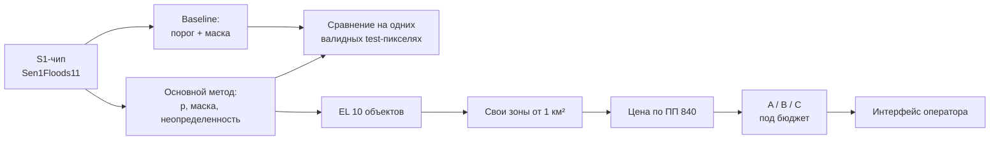

# Кейс FloodValue: разбор материалов КосмоХакатона 2026

Текущая сервисная итерация: [объединение main, раскрываемая панель и next_optical](plans/2026-09-26-panel-model-integration.md). Здесь зафиксированы новые значения, проверки и границы старого backtest.

Кейс «ИИ-оценка экономического ущерба от паводка и оптимизация заказа ДЗЗ». Здесь материалы организатора разложены по темам: что сдавать, по каким формулам считать, за что жюри ставит баллы. Исходники лежат в этой же папке:

- `source/FloodValue_Постановка_КосмоХакатон.pdf`: постановка, 23 страницы;
- `source/FloodValue_Критерии_КосмоХакатон.pdf`: 20 критериев по 0-5 баллов;
- `source/GitHub repo.txt`: ссылка на официальный [Sen1Floods11](https://github.com/cloudtostreet/Sen1Floods11).

Разбор сделан 25.09.2026. Если между разбором и PDF есть расхождение, прав PDF. Всё, что помечено «проверено», я запускал руками на данных Sen1Floods11 в тот же день.

**Для жюри:** [00-jury-guide.md](00-jury-guide.md), 20 критериев и где проверить каждый.

**Последняя полная проверка итогового ZIP из контейнера:** [18-diagnostic-after-service-iteration.md](18-diagnostic-after-service-iteration.md). Новый операторский путь — [19-operator-flow.md](19-operator-flow.md). В ней оценки всех 20 пунктов, проверенные результаты и действия до полного выполнения. [16-strict-audit-2026-09-26.md](16-strict-audit-2026-09-26.md) и более ранние обзоры сохранены как исторические оценки.

## Кейс в одном абзаце

По Sentinel-1 из официального Sen1Floods11 находим воду двумя методами: пороговым baseline и собственным основным методом, который выдает вероятности. На одном чипе случайно, с фиксированным seed, расставляем 10 условных объектов и по вероятностям основного метода считаем ожидаемый ущерб `EL = p × V × q` вместе с неопределенностью. Сами рисуем зоны дополнительной съемки (полигоны от 1 км²), считаем их цену по формуле ПП РФ № 840 и выбираем план под бюджет, который объявляем сами. Сравниваем стратегии A (без платной съемки), B (широкая закупка) и C (выборочная). Показываем всё в интерфейсе оператора: смена бюджета пересчитывает план без переобучения. Код, веса и README кладем в GitVerse.

## Цепочка, которую проверяет жюри

Экономический контур (EL, зоны, A/B/C) строится только по основному методу. Для baseline обязательны бинарная маска и метрики сегментации, больше ничего.

## Карта документов

| Файл | Что внутри | Критерии |
|---|---|---|
| [01-case-overview.md](01-case-overview.md) | постановка, пользователь, обязательное и свободное, чего организатор не дает, границы | все |
| [02-data-sen1floods11.md](02-data-sen1floods11.md) | доступ к данным, структура бакета, проверенные свойства чипа, авторский split, ловушки | 1, 6, 7 |
| [03-methods-validation.md](03-methods-validation.md) | baseline, основной метод, цикл обучения, split без утечки, эксперименты, калибровка, неопределенность | 2-10 |
| [04-economics-assets.md](04-economics-assets.md) | 10 объектов, генерация портфеля, EL, статусы, прокси-проверка, чувствительность | 13, 14 |
| [05-procurement-pricing.md](05-procurement-pricing.md) | зоны и площадь, формула ПП 840, коэффициенты, скидка, округление, A/B/C | 15-18 |
| [06-deliverables.md](06-deliverables.md) | все файлы сдачи с полями, README GitVerse, интерфейс, сценарий защиты | 11, 12, 19 |
| [07-scoring-checklist.md](07-scoring-checklist.md) | 20 критериев с артефактами и итоговый чек-лист | все |
| [08-status.md](08-status.md) | текущая готовность по 20 критериям, проверенные факты, пробелы и ближайший план | все |
| [09-jury-session.md](09-jury-session.md) | выводы встречи с жюри 26.09 и сверка с текущим решением: зоны сомнений, постоянная вода, обоснование параметров, вопросы к защите | все |
| [10-pitch.md](10-pitch.md) | для питча: ответы на предупреждения экспертов, что реально взяли из их статей, детали, которые заметит жюри | все |
| [11-pilot.md](11-pilot.md) | план пилота у инфраструктурного оператора: этапы, данные от оператора, метрики постановки, критерии остановки | 20 |
| [12-current-review.md](12-current-review.md) | сверка версии 3bbad6b по всем 20 критериям, подтверждённый запуск и приоритеты развития | все |
| [13-model-audit.md](13-model-audit.md) | последний пакет модели, свежая проверка на 105 чипах, ограничения независимости и план улучшений ML | 1–14 |
| [14-service-delivery-review.md](14-service-delivery-review.md) | предыдущая оценка реализации и браузерной проверки; сохранена как исторический снимок | все |
| [16-strict-audit-2026-09-26.md](16-strict-audit-2026-09-26.md) | актуальная строгая сверка ветки, интерфейса и ZIP с 20 критериями; список действий до 10/10 | все |
| [17-roadmap-to-10.md](17-roadmap-to-10.md) | обновлённая таблица пользователя, конкретные доказательства до 10/10 и план проверки | все |
| [18-diagnostic-after-service-iteration.md](18-diagnostic-after-service-iteration.md) | новая сверка всех 20 пунктов после сервисной итерации, доказательства и остаток до 10/10 | все |
| [19-operator-flow.md](19-operator-flow.md) | путь оператора: импорт, коммерческий архив SkyFi, сохранённый черновик, статусы и ограничения | 19 |
| [20-user-roles.md](20-user-roles.md) | путь пользователя по ролям: дежурный аналитик оператора или МЧС, заказчик съёмки, страховой аналитик, оператор ДЗЗ, региональный штаб, эксперт по качеству | 19 |
| [08-repo-gap.md](archive/08-repo-gap.md) | исторический аудит предыдущего прототипа; к нынешней структуре не относится | - |

## Ключевые числа

| Что | Значение |
|---|---|
| Баллы | 100: технические 60, отраслевые 40; 20 критериев по 0-5 |
| Sen1Floods11 | 11 событий, 4 831 чип, из них 446 с ручной разметкой |
| S1-чип | 512 × 512, 2 канала VV/VH, Float32, dB, EPSG:4326, шаг около 10 м |
| Портфель | 10 точек, по одной каждого типа; ΣV = 129 млн ₽; Σ(V·q) = 35,4 млн ₽ (это EL при p = 1 везде) |
| Контрольный пример EL | p = 0,4; V = 10 млн; q = 0,25 → EL = 1 млн ₽ |
| Зона съемки | один Polygon без вырезов, от 1 км² до округления, площадь с точностью 0,001 км² |
| Ставка Б | 788,64 ₽/км², сценарная, `base_rate_status=scenario` |
| Норматив | ПП РФ № 840, редакция от 27.08.2025, контрольная дата 20.09.2026 |
| Контрольная цена | 1 км², оптика 1 м, L2, internal, новая съемка → 1 703,46 ₽ |
| nodata в растрах | `flood_probability.tif`: -9999; `flood_mask.tif`: 255 |
| Горизонт оператора | 6-12 часов (целевой сценарий продукта, не время на обучение) |

## Что стоит уточнить у организаторов

Нашел четыре места, где материалы можно прочитать по-разному:

1. В постановке слой ручных меток называется QC, а в бакете v1.1 это `LabelHand` (`v1.1/data/flood_events/HandLabeled/LabelHand/`). По содержанию совпадает (-1/0/1), но формулировку «метка QC» в отчете лучше привязать к фактическому имени файла.
2. Файл с метриками двух методов обязателен (критерий 12), но его имя и поля не стандартизированы. Предлагаю `metrics.csv` с одной строкой на пару (метод, событие) плюс итоговые строки, и ссылку на него в `run_metadata.json`.
3. Слово «baseline» встречается в двух смыслах: пороговый метод и значение `uncertainty_status=baseline` для стратегии A в `strategy_comparison.csv`. Во втором случае это «исходная неопределенность», к пороговому методу отношения не имеет.
4. Бюджет не задан: «объявленный бюджет» команда выбирает сама и записывает в `run_metadata.json`. Жюри может поменять его на защите.

Материалы по теме от организатора: https://disk.360.yandex.ru/d/xehr4MEGjTQ4pg
