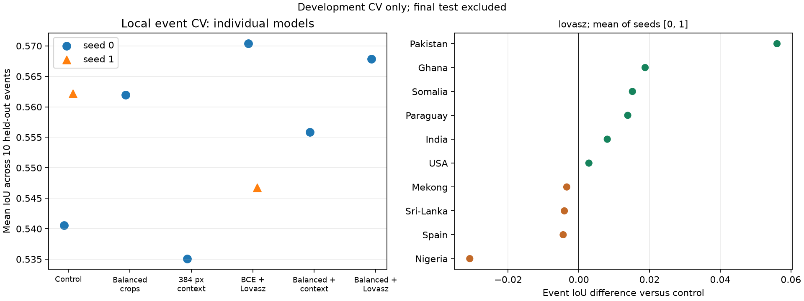

# Локальные ML-эксперименты — 25.09.2026

Завершены 24 обучения, проверки двух seed, TTA, смесей и калибровки. Практический кандидат для дальнейшей проверки — ансамбль двух seed BCE+Lovász с isotonic без TTA. При сравнении с контрольным ансамблем той же мощности и с той же калибровкой средний IoU событий вырос 0,5587 → 0,5676, общий IoU 0,5949 → 0,6046, Brier снизился 0,03578 → 0,03437. ECE при этом немного хуже — см. таблицу ниже.

**Одиночный Lovász не показал устойчивого прироста на двух seed.** Результат ансамбля — локальный CV-кандидат, не подтверждённая замена опубликованного v1. Все новые модели в этой серии обучались по сокращённому расписанию; перед заменой v1 нужна проверка выбранного рецепта на полном бюджете обучения.

## Что сравниваем

Три fold с исключением целых событий, 341 development-чип, 10 событий. Train и внутренняя validation не содержат событий внешнего fold. Checkpoint, нормализация, калибровка и порог не используют его метки. Test_core, test_adjacent и Bolivia исключены из подбора. Основная метрика — среднее pooled IoU десяти событий (каждое событие имеет одинаковый вес); дополнительная — общий pooled IoU всех 77 553 411 валидных пикселей.

Это development CV для подбора настроек. Повторный seed проверяет случайность обучения на тех же данных, а не является новым независимым тестом. Опубликованные 0,697 на test_core и 0,655 на Bolivia получены на другом разбиении и ансамбле пяти моделей; напрямую сравнивать с этой таблицей нельзя.

Все варианты: U-Net/ResNet34, ImageNet, VV/VH, 30 эпох × 2 кропа/чип, одинаковое оборудование Apple MPS float32. Базовое окно 256, batch 8. [Подробный протокол](CV_PROTOCOL.md), [план с именами чипов](cv_plan.json), [окружение](cv_environment.json), [SHA-256 исходников](cv_source_sha256.json).

## Скрининг: seed 0

В таблице одна модель на fold, без TTA, Platt и порог по внутренней validation. Время — сумма собственно обучения трёх fold относительно контроля, без калибровки и записи прогнозов.

| Вариант | Средний IoU событий ↑ | Общий IoU ↑ | Brier ↓ | Обучение |
|---|---:|---:|---:|---:|
| Контроль: BCE + Dice | 0.5406 | 0.5752 | 0.03820 | 1.00× |
| Балансировка кропов | 0.5620 | 0.5928 | 0.03630 | 0.98× |
| Окно 256 → 384 | 0.5351 | 0.5777 | 0.03756 | 1.34× |
| BCE + Lovász | 0.5704 | 0.6021 | 0.03768 | 1.07× |
| Балансировка + окно 384 | 0.5558 | 0.5766 | 0.03759 | 1.34× |
| Балансировка + Lovász | 0.5678 | 0.5967 | 0.03602 | 1.04× |

BCE+Lovász поднял IoU на всех десяти событиях первого seed. Precision 0,7393 → 0,7811 при recall 0,7216 → 0,7243: основной выигрыш — снижение ложных срабатываний. Время обучения выросло на 7,5%, архитектура и число проходов на inference те же. Здесь Lovász применяется с первого шага; позднее переключение BCE/Dice → Lovász не проверялось.

Балансировка выбирает половину кропов равномерно, половину поровну из пяти диапазонов площади воды, включая полностью сухие кропы. Она улучшила 6 из 10 событий и не добавляет стоимости inference. Окно 384 и его сочетание с sampler не окупили дополнительное время. Шестой вариант sampler+Lovász добавлен адаптивно после положительных результатов отдельных приёмов; он не превзошёл отдельный Lovász.

## Подтверждение другим seed

Лидер выбран по первому seed и записан до второго запуска: [cv_selection.json](cv_selection.json). Никакие настройки перед seed 1 не менялись. Все 24 обучения завершены: шесть конфигураций × три fold первого seed, контроль и Lovász × три fold второго seed.

| Seed | Контроль, средний IoU | Lovász, средний IoU | Разница | Brier контроля | Brier Lovász |
|---|---:|---:|---:|---:|---:|
| 0 | 0.5406 | 0.5704 | +0.0298 | 0.03820 | 0.03768 |
| 1 | 0.5622 | 0.5468 | -0.0154 | 0.03626 | 0.04600 |

Среднее по двум seed: 0.5514 → 0.5586 (+0.72 п.п.). **Выигрыш Lovász не подтвердился одинаковым знаком на двух seed.** На seed 1 ухудшился и Brier с Platt. Прироста первого seed недостаточно для замены основной loss; ансамбли и калибровка проверяются отдельно. Повторный seed не делает ранее использованные CV-события независимым тестом.

## Калибровка: seed 0

Каждый калибратор обучен только на внутренней validation соответствующего fold. Isotonic монотонна: почти не меняет качество ранжирования и IoU, но может улучшать значения вероятностей. Разница IoU порядка 0,001 связана также с плато и сеткой выбора порога 0,01.

| Вариант | Brier Platt | Brier isotonic | ECE Platt | ECE isotonic |
|---|---:|---:|---:|---:|
| Контроль: BCE + Dice | 0.03820 | 0.03787 | 0.01586 | 0.01198 |
| Балансировка кропов | 0.03630 | 0.03589 | 0.01283 | 0.00946 |
| BCE + Lovász | 0.03768 | 0.03498 | 0.02143 | 0.01156 |

ECE здесь — среднее ECE трёх fold, взвешенное по числу валидных пикселей, с 15 равными корзинами; это не ECE объединённой выборки. Temperature scaling на контроле не превзошёл Platt. На втором seed улучшение Brier от isotonic повторилось у контроля и Lovász; ниже приведены результаты.

## Второй seed: калибровка

| Вариант | Brier Platt | Brier isotonic | ECE Platt | ECE isotonic |
|---|---:|---:|---:|---:|
| Контроль | 0.03626 | 0.03552 | 0.01459 | 0.01032 |
| Lovász | 0.04600 | 0.03599 | 0.02757 | 0.01050 |

Isotonic — наиболее последовательное улучшение вероятностей в этой серии: Brier уменьшился на обоих seed обеих проверяемых моделей. У Lovász seed 1 разница Brier между Platt и isotonic особенно велика. Калибровка улучшает вероятность, но не устраняет нестабильность самой сегментации.

## Ансамбли и TTA

В каждой строке два обученных seed 0/1; среднее логитов, веса 0,5/0,5. Порог и калибровка заново подбираются по внутренней validation конкретного ансамбля. Isotonic на ансамблях — дополнительная проверка сочетания после положительных результатов калибровки одиночных моделей.

| Два seed | Средний IoU событий | Общий IoU | Brier | ECE | Проходов сети |
|---|---:|---:|---:|---:|---:|
| Контроль + Platt | 0.5593 | 0.5950 | 0.03633 | 0.01401 | 2 |
| Контроль + isotonic | 0.5587 | 0.5949 | 0.03578 | 0.00975 | 2 |
| Lovász + Platt | 0.5672 | 0.6042 | 0.03858 | 0.02491 | 2 |
| Lovász + isotonic | 0.5676 | 0.6046 | 0.03437 | 0.01077 | 2 |
| Контроль + isotonic + TTA | 0.5593 | 0.5963 | 0.03538 | 0.00955 | 8 |
| Lovász + isotonic + TTA | 0.5737 | 0.6090 | 0.03397 | 0.01079 | 8 |

При одинаковых двух проходах Lovász+isotonic превосходит контроль+isotonic на 0,88 п.п. среднего IoU и на 0,96 п.п. общего IoU, снижает Brier на 3,95%, но не улучшает ECE. Это умеренное преимущество одной проверенной пары seed, а не доказательство превосходства для любой инициализации или нового события.

TTA — повороты 0/90/180/270 с возвращением ориентации перед усреднением. На одиночном контроле оно дало +0,27/+0,12 п.п. среднего IoU на seed 0/1. В ансамбле контроля с isotonic прирост всего +0,06 п.п.; у ансамбля Lovász +0,61 п.п. при четырёхкратном числе проходов. Для варианта с низкой стоимостью inference TTA не включаем; для максимального измеренного качества выбранного двух-seed рецепта оставляем как опцию.

Также проверены равновесные смеси разных конфигураций первого seed: control+balanced, balanced+context, balanced+Lovász, control+Lovász; для balanced+Lovász — среднее логитов и среднее sigmoid-вероятностей. Лучший средний IoU этих смесей 0,5702 у последней пары в пространстве вероятностей, Brier 0,03557. Это только один seed, поэтому небольшой перевес над ансамблем двух seed не рассматривается как подтверждённое преимущество. Результаты всех смесей сохранены в JSON.



## Решение по этой итерации

- В первую очередь сохраняем isotonic как полезную настройку вероятностей, с отдельной подгонкой на разрешённой validation для каждой модели/ансамбля.
- Для следующей проверки на полном бюджете сохраняем рецепт двух seed Lovász + isotonic, без TTA. Одиночную loss по одному удачному seed не продвигаем.
- Балансировка перспективна по первому seed, но отдельно на втором seed не подтверждалась. Окно 384 в проверенных настройках не оправдало дополнительных затрат.
- Опубликованный ансамбль v1 и его CLI inference остаются исходными. Новая калибровка реализована в инструментах CV и оценки смесей; её интеграция в поставляемую модель требует отдельного полного прогона. Новых test-метрик в этом исследовании нет.

## Воспроизведение

Из `ml/`, после `uv sync` и `uv run floodvalue download`:

```bash
FLOODVALUE_DEVICE=mps FLOODVALUE_EVAL_BATCH=4 \
  uv run python scripts/run_cv_sweep.py \
  --configs control balanced context lovasz balanced_context balanced_lovasz --seeds 0
FLOODVALUE_DEVICE=mps FLOODVALUE_EVAL_BATCH=4 \
  uv run python scripts/run_cv_sweep.py --configs control lovasz --seeds 1
```

На CUDA убрать `FLOODVALUE_DEVICE=mps`. Численно результаты могут отличаться от MPS; сравнения нужно повторять в одной среде. Конфиги — `configs/cv/`, веса и полные прогнозы — `runs/cv/cv_r34_*/seed*/fold*/`. Законченные совпадающие прогоны пропускаются. Сводные метрики и SHA-256 весов: [cv_results.json](cv_results.json). Примеры смеси, TTA и калибровки — в [протоколе](CV_PROTOCOL.md).

Весь набор из 31 теста прошёл, включая проверки исключения тестовых событий, masked loss, градиентов nodata, балансировки и геометрии кропов, совмещения прогнозов, обратного преобразования TTA, ограниченности и монотонности калибровки, а также подгонки калибратора смеси только по внутренней validation. После добавления выбора калибратора стандартная смесь с Platt воспроизвела сохранённые ранее метрики и параметры в точности. Проверка исходного CPU-inference дала побайтово те же четыре GeoTIFF. Исходные опубликованные веса и test-метрики не заменялись.

Пример итоговой смеси на одном fold:

```bash
uv run python -m floodvalue.cv_blend \
  --runs runs/cv/cv_r34_lovasz/seed0/fold0 runs/cv/cv_r34_lovasz/seed1/fold0 \
  --weights 0.5 0.5 --space logits --calibration isotonic \
  --out runs/blends/lovasz_seeds01_isotonic_fold0.json
uv run python scripts/export_cv_results.py
uv run python scripts/plot_cv_results.py
```

Для TTA сначала выполнить `floodvalue.cv_tta` для каждого seed/fold, затем смешать их архивы с суффиксом `_rot4`. Параметры calibrator/threshold каждой смеси находятся в соответствующем `runs/blends/*.json`; прогнозы и метрики отдельных fold — в `runs/cv/`.
