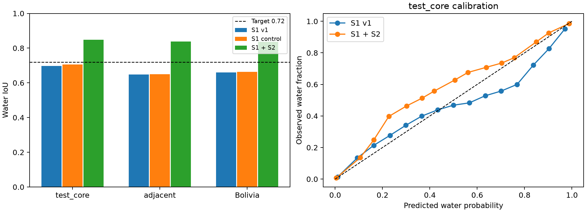

# S1+S2: отдельное расширение модели воды

Метрика — pooled IoU воды, больше лучше. Оценка использует исходные test_core (55 чипов), test_adjacent (35) и Bolivia (15), на прежних finite(VV/VH) & label-valid пикселях.

**Входы расширены оптикой Sentinel-2. Эти числа нельзя выдавать за улучшение S1-only.** Радарный v1 и ранее выпущенный S1-only рецепт 0,704383 сохранены отдельно.

| Часть | Исходный S1 v1 | S1 контроль, новый способ усреднения | S1+S2 | Brier S1+S2 |
|---|---:|---:|---:|---:|
| test_core | 0.696958 | 0.706169 | 0.848688 | 0.016959 |
| test_adjacent | 0.648442 | 0.649137 | 0.837328 | 0.015915 |
| bolivia | 0.659276 | 0.663138 | 0.836838 | 0.022826 |

Исходник повторно оценён на MPS/FP32; опубликованный результат коллеги округлялся до 0,697. Разницу устройств/точности не считаем улучшением.

Исходная validation: 0.854746. Event CV, среднее по 10 отложенным событиям: 0.774209 против 0.561452 у S1-контроля. Это другая проверка и другое число; оно не подменяет test_core.

При полном отключении S2 тот же расширенный рецепт (с уже зафиксированной общей калибровкой) даёт: test_core 0.706549, test_adjacent 0.649995, bolivia 0.670388. Это проверка деградации входов, а не новый подбор S1-модели по test.

Выбран вес оптики 0.75, вес S1 0.25; изотоническая калибровка и порог 0.45 взяты только с validation. Среди почти одинаковых validation-вариантов выбран лучший по event CV. Рецепт и контрольные суммы зафиксированы до новых test-прогнозов.

Парный bootstrap по test_core-чипам: 95% интервал прироста относительно v1 [+0.099399, +0.219899]. Чипы внутри событий зависимы; это описательная оценка.

## Данные и ограничения

Бустинг обучается на исходных train-чипах, по 3500 случайных пикселей с каждого допустимого чипа. Признаки: 13 полос S2, спектральные индексы и местные средние плюс VV/VH-текстуры. Координаты, ID события и тестовые метки в признаки не входят.

S2 допускается только в тот же календарный день, что S1, или на 1–2 дня раньше. В Ghana и Spain оптика снята позже, поэтому используется радарный прогноз. Время суток неизвестно: доступность на точный момент съёмки не доказана. S2Hand не содержит QA/cloud-mask; облачность может портить результат. Пиксели с облаками или без допустимой S2 не исключаются из оценки. Без S2 и при отсутствии дат инференс использует S1 fallback.

**Происхождение разметки.** Метки Sen1Floods11 получены ручным исправлением классификации по Sentinel-2 с просмотром S2-композитов и S1 VH. Поэтому S2 на инференсе предоставляет информацию из источника построения меток. Оценка 0,848688 характеризует режим с доступной оптикой; отдельные S1-результаты и проверка без S2 приведены выше. [Первичная статья, раздел Hand Labeling](https://www.grss-ieee.org/wp-content/uploads/earthvision2020/july_stuff/webpage/papers/Bonafilia_Sen1Floods11_A_Georeferenced_Dataset_to_Train_and_Test_Deep_Learning_CVPRW_2020_paper.pdf).

Вероятность и маска сохраняют исходный GeoTIFF-контракт. В расширенном режиме uncertainty = половина абсолютного расхождения вероятностей S1 и S2, а на fallback-пикселях — разброс радарного ансамбля. Это индикатор несогласия моделей, не доверительный интервал. AUROC этого индикатора для ошибок отдельно сохранён по всем частям в JSON.

Validation и CV использовались для разработки, а прежний test-score уже был известен. Финальный test не следует называть впервые открытым слепым тестом. Новые тестовые метки не участвовали в обучении, выборе смеси, калибровке или пороге.

## Запуск без переобучения

```bash
cd ml
uv sync
uv run floodvalue download
uv run python scripts/goal072_download_s2.py --parts train valid test_core test_adjacent bolivia
uv run floodvalue infer --chip Bolivia_103757 \
  --recipe artifacts/goal072_optical/recipe.json --out outputs/optical_Bolivia_103757
uv run floodvalue infer --chip Bolivia_103757 --no-optical \
  --recipe artifacts/goal072_optical/recipe.json --out outputs/optical_fallback_Bolivia_103757
```

S2 загружается отдельно (~1,02 ГБ на все 446 чипов), с проверкой MD5. Для своего GeoTIFF передаются --s1, --s2, --s1-date и --s2-date. S2 должен содержать официальные 13 полос, reflectance×10000, точно на сетке S1. Обычная команда без --recipe по-прежнему запускает исходный S1 v1.

## Повтор обучения и проверки

```bash
uv run python scripts/goal072_prepare_optical.py
OMP_NUM_THREADS=4 uv run python -m floodvalue.optical
uv run python scripts/run_cv_sweep.py --configs cv_r34_control --seeds 0 1
OMP_NUM_THREADS=4 uv run python scripts/goal072_optical_cv.py
OMP_NUM_THREADS=4 uv run python scripts/goal072_optical_evaluate.py
uv run python scripts/export_goal072_optical.py
```

Для обучения/инференса сетей на Apple GPU задаётся FLOODVALUE_DEVICE=mps; CPU поддерживается. Численная точность CPU/MPS может немного отличаться.

Источники: [официальные данные и полосы Sen1Floods11](https://github.com/cloudtostreet/Sen1Floods11), [решения STAC Overflow с пиксельным бустингом](https://github.com/drivendataorg/stac-overflow). Это собственное обучение; готовые flood-веса сторонних команд не использованы.

[Полные метрики и аудит](goal072_optical_results.json), [журнал исследований](GOAL072_RESEARCH.md).


