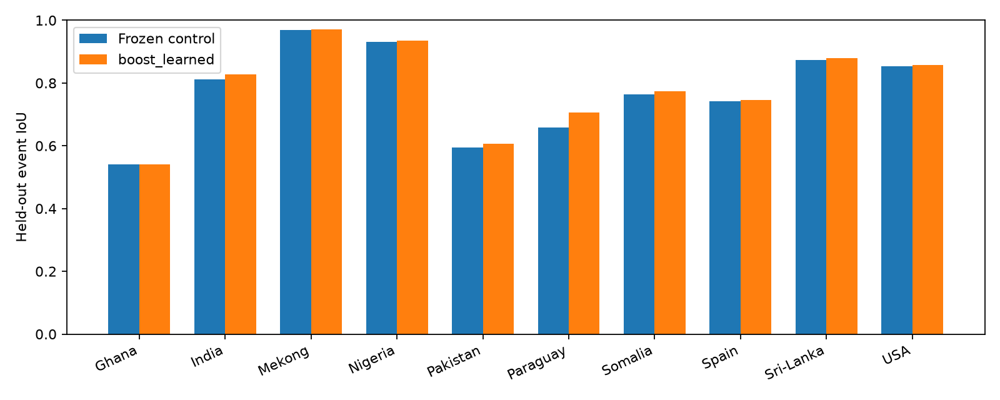

# Следующая серия ML-экспериментов

Выбор по development: **boost_learned**. Входы — **S1+S2**, с S1 fallback по прежним правилам дат.

Контроль до этой серии: test_core IoU **0,848688**, Bolivia **0,836838**. Чем выше IoU, тем лучше.
Это другой режим входов, чем исходный S1-only результат коллеги около 0,697.

## Что проверено

1. HGB с 10 000 train-пикселей на чип и до 1200 итераций; отдельно hard negatives из train-only pilot.
2. LightGBM и CatBoost; общий набор признаков и одинаковые event-фолды.
3. SAR-pretrained ResNet50 и U-Net/MiT-B2, полный бюджет и смеси с исходным радарным ансамблем.
4. Пространственная S2 U-Net/ResNet18 по шести полосам; train-only нормализация, EMA, отдельные CV-модели.
5. Простые и обученные ансамбли, смешивание по качеству изображения, отдельная калибровка S2/fallback.

## Development

Исходные train252/valid89 и три event-фолда не менялись. В каждом CV-фолде внешние события исключены из обучения базовых моделей,
метамодели и калибровки. Метамодель полной модели обучена на OOF-прогнозах исходных train-чипов;
контрольные valid-чипы выбирают калибровку и порог. Обе итоговые модели оцениваются на одинаковых пикселях S1.

В event CV радарный контроль — два ResNet34 без TTA; полный радарный контроль — пять ResNet34 с rot4.
Это ограничение переноса выбора из CV в финальную модель. У оптических экспериментов один радарный контроль;
строки `radar_*` дополнительно проверяют MiT в его составе.

В финальный выбор допускается validation IoU ≥ 0,852746. Далее максимизируется средний IoU десяти отложенных
событий; Brier разрешает равенство. Контроль тоже участвует. Правило записано до новых test-прогнозов.

| Вариант | Validation IoU | Event-CV IoU | Pooled CV IoU | CV Brier | Допущен |
|---|---:|---:|---:|---:|:---:|
| boost_learned | 0.855659 | 0.784098 | 0.821956 | 0.015990 | да |
| radar_all | 0.859212 | 0.783557 | 0.819364 | 0.015954 | да |
| radar_hgb | 0.857424 | 0.783482 | 0.821720 | 0.015766 | да |
| boost_mean | 0.855822 | 0.783187 | 0.820917 | 0.016065 | да |
| radar_all_w025 | 0.858070 | 0.782946 | 0.818621 | 0.016091 | да |
| hgb_large_0.75 | 0.854454 | 0.782912 | 0.821578 | 0.016014 | да |
| all_learned | 0.855919 | 0.782472 | 0.818355 | 0.016222 | да |
| lightgbm_0.75 | 0.855084 | 0.781912 | 0.820199 | 0.016105 | да |
| boost_gate | 0.856750 | 0.781716 | 0.824124 | 0.015396 | да |
| hgb_large_1.00 | 0.855032 | 0.781643 | 0.825249 | 0.015421 | да |
| radar_hgb_w025 | 0.856534 | 0.781297 | 0.819121 | 0.015904 | да |
| hgb_hard_0.75 | 0.854993 | 0.780873 | 0.816659 | 0.016431 | да |
| all_gate | 0.857182 | 0.780177 | 0.820783 | 0.015596 | да |
| lightgbm_1.00 | 0.855566 | 0.779810 | 0.823350 | 0.015552 | да |
| catboost_0.75 | 0.854604 | 0.779521 | 0.819296 | 0.016064 | да |
| radar_hgb_w100 | 0.854626 | 0.779439 | 0.818076 | 0.016085 | да |
| catboost_1.00 | 0.855524 | 0.778065 | 0.821643 | 0.015490 | да |
| radar_all_w100 | 0.856578 | 0.778058 | 0.814649 | 0.016332 | да |
| radar_old | 0.857703 | 0.775931 | 0.811481 | 0.016493 | да |
| hgb_hard_1.00 | 0.855701 | 0.775815 | 0.816056 | 0.015791 | да |
| control | 0.854746 | 0.774209 | 0.810709 | 0.016777 | да |
| old_gate | 0.855032 | 0.773703 | 0.813522 | 0.016179 | да |
| radar_old_w025 | 0.856796 | 0.773010 | 0.808457 | 0.016653 | да |
| radar_old_w100 | 0.854896 | 0.771378 | 0.808184 | 0.016792 | да |
| boost_branchcal | 0.856977 | 0.759748 | 0.788703 | 0.018495 | да |
| all_branchcal | 0.857149 | 0.758268 | 0.786503 | 0.018635 | да |
| cnn_blend | 0.849238 | 0.755710 | 0.786495 | 0.018364 | нет |
| old_branchcal | 0.856360 | 0.749640 | 0.777413 | 0.019384 | да |
| hgb_large_0.50 | 0.825727 | 0.736605 | 0.775643 | 0.019363 | нет |
| catboost_0.50 | 0.823532 | 0.736491 | 0.776560 | 0.019383 | нет |
| lightgbm_0.50 | 0.825870 | 0.736391 | 0.775696 | 0.019391 | нет |
| hgb_hard_0.50 | 0.823697 | 0.723402 | 0.762554 | 0.020042 | нет |
| cnn_0.75 | 0.819950 | 0.690345 | 0.712756 | 0.024458 | нет |
| cnn_0.50 | 0.802350 | 0.679297 | 0.709711 | 0.025081 | нет |
| cnn_1.00 | 0.818717 | 0.675980 | 0.700946 | 0.025460 | нет |

Среднее по событиям не следует сравнивать с pooled test IoU: это разные выборки и способы усреднения.
95% bootstrap-интервалы по десяти событиям сохранены в JSON. Они описательные: CV использовалась для отбора моделей.



## Радарные архитектуры

Ниже лучший validation-вариант каждой архитектуры в смеси с прежним S1-ансамблем. Оптика в этих строках не используется.

| Архитектура | TTA | Вес новой модели | S1 validation IoU |
|---|---|---:|---:|
| unet_sar50 | none | 0.25 | 0.717048 |
| unet_mitb2 | rot4 | 0.50 | 0.726142 |

Прежний S1-ансамбль на этой validation: 0,717470. Все отдельные и гибридные результаты сохранены в JSON.

## Финальная проверка

Параметры и контрольные суммы зафиксированы до получения новых test-прогнозов. Проверен ровно один выбранный вариант.

| Часть | Прежний S1+S2 | Новый S1+S2 | Новый без S2 |
|---|---:|---:|---:|
| test_core | 0.848688 | 0.849383 | 0.706598 |
| test_adjacent | 0.837328 | 0.838132 | 0.650309 |
| bolivia | 0.836838 | 0.837351 | 0.672399 |

95% описательный парный bootstrap разности test_core IoU: [-0.001081, +0.002369].
Чипы одного события могут коррелировать; это не независимый новый набор событий.
Интервал включает ноль: наблюдаемый выигрыш небольшой и не подтверждает устойчивое превосходство на test_core.

Чистый S1 с собственной заранее выбранной калибровкой/порогом радарного рецепта:

- test_core: 0.706169.
- test_adjacent: 0.649137.
- bolivia: 0.663138.

Исходный пакет `artifacts/goal072_optical` сохранён. Новый пакет: `artifacts/next_optical/recipe.json`.

Связь неопределённости с ошибками (AUROC, та же выборка до 1 млн пикселей, seed72):

| Часть | Прежняя неопределённость | Новая неопределённость |
|---|---:|---:|
| test_core | 0.843180 | 0.849677 |
| test_adjacent | 0.914400 | 0.917028 |
| bolivia | 0.890846 | 0.898047 |

## Время оптической части на CPU

Чип `India_1050276` — первый допустимый по датам в исходном списке validation.
Медиана трёх прогонов после прогрева; включает признаки, исключает загрузку файлов/весов и радарный ансамбль.
На машине параллельно шли исследования, поэтому это ориентир стоимости, не изолированный benchmark.

| Модель | Секунд/чип |
|---|---:|
| old | 1.339 |
| hgb_large | 2.208 |
| hgb_hard | 1.773 |
| lightgbm | 1.959 |
| catboost | 0.112 |
| cnn | 0.139 |

## Проверка поставляемого пакета

CLI-инференс выполнен на CPU; контрольные суммы моделей, автономность путей, CRS, сетка, dtype, nodata и связь маски с порогом проверены.
Среднее абсолютное отличие CPU-вероятностей от исследовательского прогона: 3.99e-09; доля отличающихся бинарных пикселей: 0.
Исходные пять радарных checkpoint не изменились.

## Воспроизведение

Из папки `ml/`, после подготовки данных и контрольных CV-кэшей из [предыдущего отчёта](GOAL072_OPTICAL_RESULTS.md):

```bash
uv sync --group research --group dev
# На этом Mac LightGBM использует уже установленную библиотеку OpenMP от torch:
export DYLD_LIBRARY_PATH="$PWD/.venv/lib/python3.13/site-packages/torch/lib${DYLD_LIBRARY_PATH:+:$DYLD_LIBRARY_PATH}"
export OMP_NUM_THREADS=4
uv run python -m floodvalue.next_boost --stage full
uv run python -m floodvalue.next_boost --stage cv
# FLOODVALUE_DEVICE=mps можно задать на Mac; без него используется CPU.
uv run python scripts/goal072_architectures.py --names unet_sar50 unet_mitb2
uv run python scripts/next_radar_screen.py
uv run python -m floodvalue.optical_cnn --stage all
uv run python scripts/next_fusion.py
uv run python scripts/next_branchcal.py
uv run python scripts/next_radar_cv.py
uv run python scripts/next_radar_weights.py
uv run python scripts/next_select.py --freeze
uv run python scripts/next_evaluate.py
FLOODVALUE_DEVICE=cpu uv run floodvalue infer --chip Bolivia_103757 --recipe artifacts/next_optical/recipe.json --out outputs/next_Bolivia_103757
uv run python scripts/next_verify.py
uv run python scripts/export_next_results.py
```

Модели и предсказания возобновляются из `runs/next/`. Нейросети сохраняют состояние обучения каждую эпоху.
Для SAR-предобучения нужен исходный checkpoint, описанный в [исследовательском журнале](GOAL072_RESEARCH.md).

## Ограничения

Sen1Floods11 hand labels создавались исправлением классификаций S2: доступ к S2 связан с источником аннотаций.
Это преимущество входных данных следует учитывать при сравнении с S1-only. Исходный test уже был известен до этой серии;
новый результат не называется первым слепым тестом. Дата S2 не позже S1 и максимум на два дня раньше, но время суток
в метаданных отсутствует. Ни пропуски оптики, ни облака не удаляют S1-пиксели из оценки.

Неопределённость — разброс моделей, не доверительный интервал.

Источник разметки: [Sen1Floods11, Hand Labeling](https://www.grss-ieee.org/wp-content/uploads/earthvision2020/july_stuff/webpage/papers/Bonafilia_Sen1Floods11_A_Georeferenced_Dataset_to_Train_and_Test_Deep_Learning_CVPRW_2020_paper.pdf).
